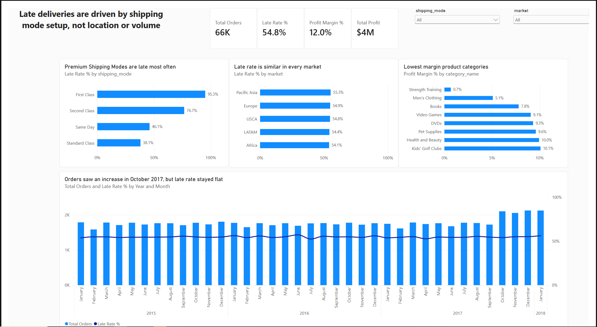

# Supply Chain Delivery Analysis

## Business Problem
Over half of DataCo's orders arrive late. This project uses SQL and Power BI
to find out what drives late deliveries, whether they cost the company money,
and what should be done about it.

## Approach
1. Loaded the raw dataset (180,519 order items) into MySQL
2. Split it into 4 related tables (customers, products, orders, order items)
   and converted text fields into proper dates and numbers
3. Answered 5 business questions in SQL, writing up findings for each
4. Built a one-page Power BI dashboard summarizing the results

## Key Findings
- **Premium shipping is late most often.** First Class is late 95.3% of the
  time: every First Class order took 2 days against a 1-day promise. Second
  Class is late 76.7% of the time, taking 2 to 6 days against a 2-day promise.
- **Location doesn't drive lateness.** All five markets had late rates between
  54.1% and 55.3%, and Second Class ran about 75% late in every region.
- **Late orders cost little in direct margin.** Late orders earned $59.37 per
  order vs. $62.37 for on-time orders (about $108K less overall).
- **Discounts don't hurt margins, but some categories barely break even.**
  Margins stayed between 11.8% and 12.4% at every discount level. Strength
  Training (0.7%), Men's Clothing (5.1%), and Books (7.8%) had the thinnest margins.
- **Volume rose about 20% in October 2017** when the product lineup shifted
  from sporting goods to electronics, media, and kids' products, yet the late
  rate stayed around 55%.

## Recommendations
1. **Fix shipping mode promises and processes.** Reset the First Class promise
   to a realistic 2-day window, and review the Second Class process, including
   carriers, since it runs about 75% late everywhere.
2. **Measure the retention cost of late deliveries.** The direct margin cost is
   small, but premium customers who pay for fast shipping and don't get it may
   not come back.
3. **Review low-margin categories,** starting with Strength Training, through
   pricing, supplier costs, or reduced promotion.

## Data Notes
- Canceled orders show $160K in profit despite never shipping, which is likely
  a recording issue in the dataset.
- Margins stay flat across discount levels, which is unusual in real retail
  data and may reflect how profit is calculated in this dataset.
- The October 2017 product shift happened in a single month. A seasonal effect
  was ruled out, since October 2015 and 2016 showed no similar change.

## Further Analysis
- Compare repeat-order rates for customers whose orders arrived late vs. on time
- Find what causes the variation in Second Class delivery times
- Check whether the new categories use premium shipping more often
- Compare margins by individual product within low-margin categories

## Files
- `01_dataco_load.sql`: loads the raw CSV into MySQL
- `02_dataco_tables.sql`: splits the data into 4 clean tables
- `03_dataco_analysis.sql`: the 5 business questions and findings
- `dataco_dashboard.pbix`: Power BI dashboard (PDF and PNG versions included)

## Tools
MySQL · MySQL Workbench · Power BI

## Data Source
[DataCo Smart Supply Chain dataset on Kaggle](https://www.kaggle.com/datasets/shashwatwork/dataco-smart-supply-chain-for-big-data-analysis)
